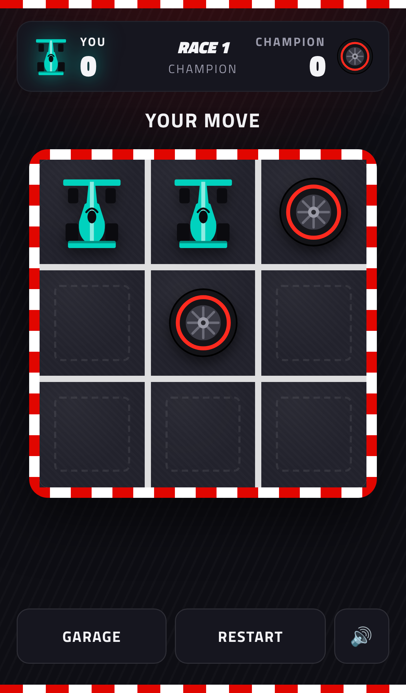

# Grid Tac Toe 🏁

**▶ Play now: https://grid-tac-toe.netlify.app** (open it on your phone)

A Formula 1 themed tic-tac-toe game for your phone. You race your car against a computer rival's tyres on a 3×3 starting grid. Get three in a row to take the chequered flag.

<p>
  
  
</p>

## Features

- **Single player vs the computer**, with three rivals:
  - **Rookie** (hard-compound white tyre) plays mostly at random. Good for kids and first-timers.
  - **Pro** (medium yellow) wins and blocks reliably but can be beaten with a fork.
  - **Champion** (soft red) plays perfectly and can't be beaten. A draw is a great result.
- **Start-lights sequence**: five red lights, then lights out (tap to skip).
- **Pick your livery** from six car colours.
- **Pole position**: you start, the rival starts, or alternate each race.
- **Championship points**: 25 for a win, 10 for a draw. Points and W/D/L are saved on the device.
- Engine and tyre sound effects (synthesised, no audio files), haptics (native on iPhone and Android in the app), and confetti when you win.
- **Mobile-first**: one-handed play, safe-area aware for notched phones, no zooming or scrolling during a race.
- **Installable PWA** that works offline after the first visit.
- Accessible: real buttons with screen-reader labels, arrow-key navigation, and reduced-motion support.

## Play it

**On the web:** https://grid-tac-toe.netlify.app. Add it to your home screen (iPhone: Share → *Add to Home Screen*; Android: ⋮ → *Install app*) and it works offline.

**Locally:** the game is a static site in `www/` with no build step.

```bash
npm install
npm start              # http://localhost:5173
```

## Native apps (App Store / Google Play)

`ios/` and `android/` are [Capacitor](https://capacitorjs.com) projects that package `www/` as native apps,
with native haptics, a splash screen and portrait lock. See:

- **[RELEASE.md](RELEASE.md)**: step-by-step build, signing and store submission from a Mac.
- **[STORE.md](STORE.md)**: ready-to-paste store listing text, privacy and rating answers.
- **`store/`**: App Store and Play screenshots and the feature graphic.

After changing anything in `www/`, run `npx cap sync` to copy it into the native projects.

## Project layout

| Path | What it does |
| --- | --- |
| `www/index.html` | Screens (garage, race, start lights, result) and the car/tyre SVG sprites |
| `www/styles.css` | All styling and animations |
| `www/app.js` | UI, game flow, sound, haptics, saved stats |
| `www/game.js` | Pure game logic and the three AI difficulty levels |
| `www/privacy.html`, `www/support.html` | Privacy policy and support pages (store requirements) |
| `www/sw.js`, `www/manifest.webmanifest`, `www/icons/` | PWA install and offline support |
| `www/fonts/` | Titillium Web, bundled (SIL Open Font License) |
| `ios/`, `android/`, `capacitor.config.json` | Native app projects |
| `assets/`, `scripts/` | Icon/splash sources and the generators for icons and store screenshots |
| `test/game.test.js` | Logic tests, including an exhaustive check that Champion never loses |

## Tests

```bash
npm test
```

Requires Node 18+.

---

An independent fan project, not affiliated with or endorsed by Formula 1 or any team.
