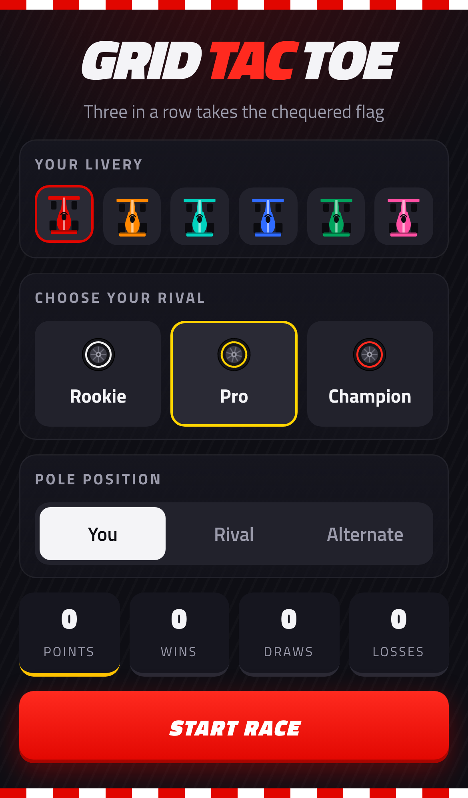

# Grid Tac Toe 🏁

A Formula 1 themed tic-tac-toe game for your phone. You race your car against a computer rival's tyres on a 3×3 starting grid. Get three in a row to take the chequered flag.

<p>
  
  
</p>

## Features

- **Single player vs the computer**, with three rivals:
  - **Rookie** (hard-compound white tyre) plays mostly at random. Good for kids and first-timers.
  - **Pro** (medium yellow) wins and blocks reliably but can be beaten with a fork.
  - **Champion** (soft red) plays perfectly and can't be beaten. A draw is a great result.
- **Start-lights sequence**: five red lights, then lights out (tap to skip).
- **Pick your livery** from six car colours.
- **Pole position**: you start, the rival starts, or alternate each race.
- **Championship points**: 25 for a win, 10 for a draw. Points and W/D/L are saved on the device.
- Engine and tyre sound effects (synthesised, no audio files), haptic buzzes on Android, and confetti when you win.
- **Mobile-first**: one-handed play, safe-area aware for notched phones, no zooming or scrolling during a race.
- **Installable PWA** that works offline after the first visit.
- Accessible: real buttons with screen-reader labels, arrow-key navigation, and reduced-motion support.

## Play it

It's a static site with no build step and no dependencies. Serve the folder over HTTP:

```bash
npm start              # serves on http://localhost:5173
# or
python3 -m http.server 5173
```

To try it on your phone, open the address from a phone on the same Wi-Fi (`http://<your-computer-ip>:5173`), or deploy the folder to any static host (GitHub Pages, Netlify, Vercel, Cloudflare Pages).

**Install it like an app:**
- **iPhone (Safari):** Share → *Add to Home Screen*
- **Android (Chrome):** ⋮ menu → *Install app* / *Add to Home screen*

Once installed, it opens full screen and works offline.

## Project layout

| File | What it does |
| --- | --- |
| `index.html` | Screens (garage, race, start lights, result) and the car/tyre SVG sprites |
| `styles.css` | All styling and animations |
| `app.js` | UI, game flow, sound, haptics, saved stats |
| `game.js` | Pure game logic and the three AI difficulty levels |
| `sw.js`, `manifest.webmanifest`, `icons/` | PWA install and offline support |
| `test/game.test.js` | Logic tests, including an exhaustive check that Champion never loses |

## Tests

```bash
npm test
```

Requires Node 18+.

---

An independent fan project, not affiliated with or endorsed by Formula 1 or any team.
